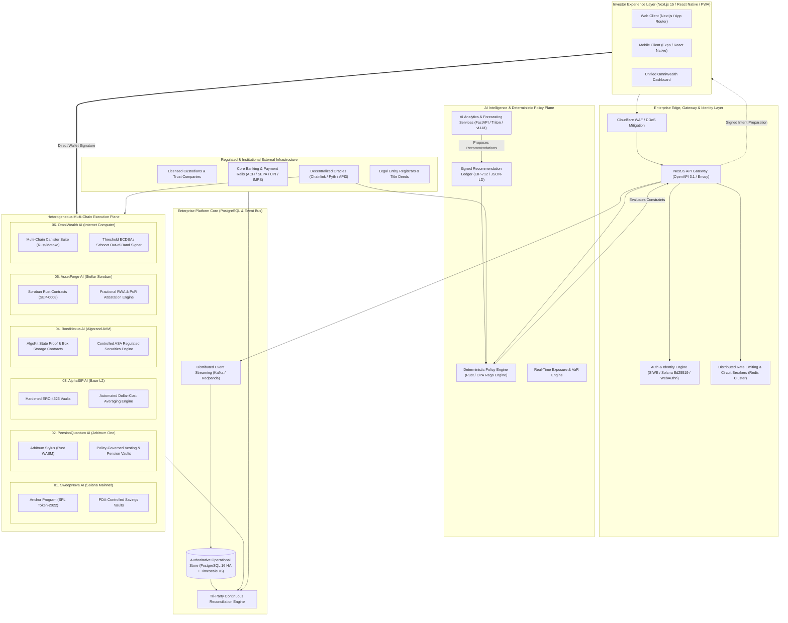
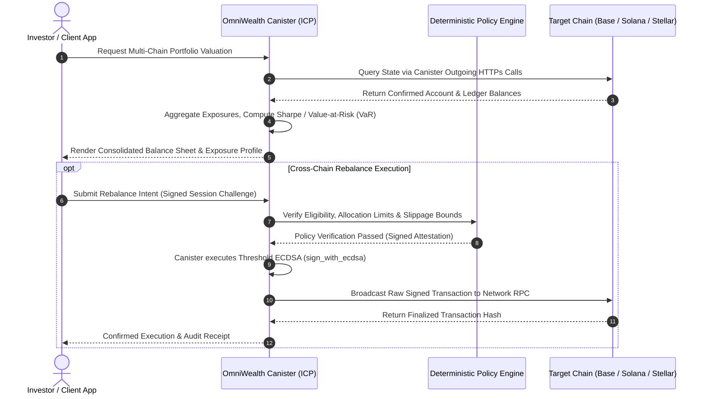

# Web3 + AI Investment Ecosystem: Enterprise Master Architecture & Engineering Execution Plan (v5.0)

**Baseline Date:** October 28, 2026  
**Document Revision:** 5.0 — Detailed Engineering Design Package & Implementation Specification  
**Namespace / Organization:** [`github.com/elon00`](https://github.com/elon00)  
**Classification:** Enterprise Engineering Blueprint & System Architecture Reference  
**Authoritative Scope:** 6 Independent Web3 Applications, 18 Regulated & Digital Asset Classes, 6 Heterogeneous Blockchain Environments, 1 Shared Deterministic AI Governance Control Plane, Unified Investor Interface.

---

## 1. Executive Blueprint & System Topology

### 1.1 Architectural Vision & Core Axiom
The Web3 + AI Investment Ecosystem is designed as an institutional-grade, multi-chain wealth engineering platform. The central architectural axiom of this system is the **Strict Separation of the Financial Execution Plane from the AI Intelligence Plane**:
$$\text{Execution Authority} \cap \text{AI Decision Space} = \emptyset$$

Under no circumstances does an artificial intelligence, machine learning model, large language model (LLM), or algorithmic heuristic possess autonomous, unconstrained cryptographic signing keys or direct transacting authority over investor assets or protocol vaults. Models propose structured, cryptographically hashed intents; deterministic policy engines validate invariance and compliance; authorized human principals or bounded, revocable smart mandates execute transactions.



### 1.2 Multi-Chain Ecosystem Characterization & Finality Matrix

| Project | Network | VM / Architecture | Core Smart Contract Stack | Consensus & Finality Model | Reorg Depth & Settlement SLA |
| :--- | :--- | :--- | :--- | :--- | :--- |
| **01. SweepNova AI** | Solana | Sealevel (Parallel BPF) | Rust 1.79+, Anchor 0.30+, SPL Token-2022 | Proof of History (PoH) + Tower BFT; 32 slots (~12.8s) for rooted finality | Reorgs rare beyond 1 slot; confirmation at `confirmed`, execution finality at `finalized`. |
| **02. PensionQuantum AI** | Arbitrum | Nitro / Stylus (WASM + EVM) | Rust (no_std via `stylus-sdk`), Alloy, EVM ABI | Nitro Sequencer soft-finality (~250ms), L1 Ethereum rollup finality (~12-15 mins) | Reorgs tied to Ethereum L1 state; disputes resolved via WASM fraud proofs. |
| **03. AlphaSIP AI** | Base | OP Stack EVM | Solidity 0.8.26, Foundry, OpenZeppelin v5 | OP Sequencer soft-finality (2s), L1 Ethereum state derivation (~12-15 mins) | Standard Optimistic L1 finality; soft confirmation accepted for off-chain queueing only. |
| **04. BondNexus AI** | Algorand | AVM (Algorand Virtual Machine) | AlgoKit, TEAL 10 / PyTeal / Beaker | Pure Proof of Stake (PPoS); Single-block finality (~3.3s) | Instant deterministic finality; zero blockchain forks / zero reorg risk. |
| **05. AssetForge AI** | Stellar | Soroban Environment | Rust, Soroban SDK v21+, Stellar Asset Contracts | Stellar Consensus Protocol (SCP) Federated Byzantine Agreement (~4-5s) | Deterministic ledger closing; zero ledger forks. |
| **06. OmniWealth AI** | Internet Computer | WebAssembly (Wasm canister) | Rust (`ic-cdk`), Motoko, Threshold ECDSA | Threshold Relay + Chain-key Cryptography (1-2s consensus) | Finalized upon block inclusion; deterministic cross-canister calls. |

---

## 2. Comprehensive Domain Specifications: 6 Applications & 18 Instrument Categories

```
┌───────────────────────────────────────────────────────────────────────────────────────────────────┐
│                                18 INVESTMENT INSTRUMENT MAPPING                                    │
├───────────────────────┬──────────────────────────┬────────────────────────────────────────────────┤
│ Application           │ Instrument Category      │ Legal & Structural Classification               │
├───────────────────────┼──────────────────────────┼────────────────────────────────────────────────┤
│ 01. SweepNova AI      │ 01. Auto-Sweep Savings   │ Bank Demand Deposit Allocation / Liquid Yield  │
│                       │ 02. Fixed Deposit (FD)   │ Term Deposit Position (Fixed Term/Fixed Rate)  │
│                       │ 03. Recurring Dep. (RD)  │ Periodic Systematic Cash Commitment Vault      │
├───────────────────────┼──────────────────────────┼────────────────────────────────────────────────┤
│ 02. PensionQuantum AI │ 04. Public Prov. Fund    │ Sovereign-guaranteed long-term debt proxy      │
│                       │ 05. Nat. Pension System  │ Multi-asset defined contribution trust         │
│                       │ 06. Post Office Schemes  │ Small savings sovereign certificates           │
│                       │ 07. SSY / SCSS           │ Targeted social welfare & senior annuities     │
├───────────────────────┼──────────────────────────┼────────────────────────────────────────────────┤
│ 03. AlphaSIP AI       │ 08. Liquid Funds         │ Ultra-short-term money market proxy (T+0/1)   │
│                       │ 09. Index Funds / ETFs   │ Passive equity index replication tokens        │
│                       │ 10. Active SIPs          │ Algorithmic, rule-governed asset allocation    │
│                       │ 11. ELSS                 │ Tax-advantaged mandatory 36-month equity lock  │
├───────────────────────┼──────────────────────────┼────────────────────────────────────────────────┤
│ 04. BondNexus AI      │ 12. Government Securities│ Direct sovereign debt obligations (T-Bills)   │
│                       │ 13. Corporate Bonds      │ Senior secured & subordinated credit tranches  │
│                       │ 14. IPO / Primary Equity │ Digital book-building & primary equity rights  │
├───────────────────────┼──────────────────────────┼────────────────────────────────────────────────┤
│ 05. AssetForge AI     │ 15. Physical Gold/Silver │ Allocated physical bullion vault receipts (PoR)│
│                       │ 16. REITs / InvITs       │ Commercial real estate infrastructure trusts   │
│                       │ 17. Fractional Real Est. │ Special Purpose Vehicle (SPV) equity shares    │
├───────────────────────┼──────────────────────────┼────────────────────────────────────────────────┤
│ 06. OmniWealth AI     │ 18. International ETFs & │ Regulated global equities + native digital     │
│                       │     Digital Assets       │ reserve assets (BTC, ETH, SOL, ICP)            │
└───────────────────────┴──────────────────────────┴────────────────────────────────────────────────┘
```

---

### 2.1 SweepNova AI — High-Velocity Savings & Automated Sweeps (Solana)

#### 2.1.1 Mission & Technical Scope
SweepNova AI provides automated, non-custodial treasury management, yield-optimizing auto-sweeps, fixed-term interest vaults, and systematic recurring deposits on Solana using parallelized transaction execution and SPL Token-2022 extensions.

#### 2.1.2 Anchor Program Account Layout & Data Structures
The Solana program utilizes explicit Program Derived Addresses (PDAs) with deterministic seeds to eliminate unauthorized state mutations.

```rust
// contracts/solana/programs/sweepnova/src/state.rs
use anchor_lang::prelude::*;

#[account]
pub struct ProtocolConfig {
    pub admin: Pubkey,
    pub emergency_multisig: Pubkey,
    pub fee_treasury: Pubkey,
    pub is_paused: bool,
    pub max_active_mandates_per_user: u16,
    pub protocol_fee_bps: u16, // Basis points (100 = 1%)
    pub bump: u8,
}

impl ProtocolConfig {
    pub const LEN: usize = 8 + 32 + 32 + 32 + 1 + 2 + 2 + 1;
}

#[account]
pub struct MintConfig {
    pub mint: Pubkey,
    pub vault_token_account: Pubkey,
    pub is_allowed: bool,
    pub decimals: u8,
    pub min_deposit_amount: u64,
    pub total_deposited: u64,
    pub bump: u8,
}

impl MintConfig {
    pub const LEN: usize = 8 + 32 + 32 + 1 + 1 + 8 + 8 + 1;
}

#[account]
pub struct UserVault {
    pub owner: Pubkey,
    pub mint: Pubkey,
    pub cumulative_deposited: u64,
    pub active_positions_count: u32,
    pub bump: u8,
}

impl UserVault {
    pub const LEN: usize = 8 + 32 + 32 + 8 + 4 + 1;
}

#[account]
pub struct DepositPosition {
    pub position_id: u64,
    pub user_vault: Pubkey,
    pub principal_amount: u64,
    pub interest_rate_bps: u32, // Fixed yield annualized
    pub creation_timestamp: i64,
    pub maturity_timestamp: i64,
    pub status: PositionStatus,
    pub withdrawn_amount: u64,
    pub bump: u8,
}

#[derive(AnchorSerialize, AnchorDeserialize, Clone, Copy, PartialEq, Eq)]
pub enum PositionStatus {
    Active,
    Matured,
    LiquidatedEarly,
    Closed,
}

#[account]
pub struct SweepMandate {
    pub mandate_id: u64,
    pub user: Pubkey,
    pub source_token_account: Pubkey,
    pub destination_vault: Pubkey,
    pub max_sweep_amount_per_period: u64,
    pub sweep_period_seconds: i64,
    pub last_sweep_timestamp: i64,
    pub total_swept: u64,
    pub expiration_timestamp: i64,
    pub is_active: bool,
    pub bump: u8,
}
```

#### 2.1.3 Instruction Execution & Safety Invariants
1. **PDA Seed Specification:**
   * `ProtocolConfig`: `b"protocol-config"`
   * `MintConfig`: `[b"mint-config", mint.key().as_ref()]`
   * `UserVault`: `[b"user-vault", owner.key().as_ref(), mint.key().as_ref()]`
   * `DepositPosition`: `[b"deposit-position", user_vault.key().as_ref(), position_id.to_le_bytes().as_ref()]`
   * `SweepMandate`: `[b"sweep-mandate", user.key().as_ref(), mandate_id.to_le_bytes().as_ref()]`
   * `VaultAuthority`: `[b"vault-authority", mint.key().as_ref()]`

2. **Automated Sweep Execution Mechanics:**
   A Solana program cannot independently transfer tokens from a user account without valid delegation or signed authority. SweepNova enforces explicit, bounded on-chain token delegation:
   * The user executes SPL Token `Approve` instruction delegating exactly $N$ tokens to the `VaultAuthority` PDA.
   * `execute_sweep` verifies:
     $$T_{\text{now}} \ge T_{\text{last}} + \Delta_{\text{period}}$$
     $$\text{Amount} \le \min(\text{AvailableDelegation}, \text{MaxSweepCap})$$
   * Fees and yields are computed using 128-bit unsigned integer math to prevent overflow:
     $$\text{Yield} = \frac{\text{Principal} \times \text{YieldBps} \times (T_{\text{matured}} - T_{\text{created}})}{10\,000 \times 31\,536\,000}$$

---

### 2.2 PensionQuantum AI — Retirement & Long-Horizon Finance (Arbitrum Stylus)

#### 2.2.1 Mission & Technical Scope
PensionQuantum AI deploys Rust smart contracts to WASM on Arbitrum Nitro via Stylus, delivering high-compute policy enforcement, 30+ year vesting schedules, legal succession/beneficiary hierarchies, and early-stage experimental post-quantum key transition verification.

#### 2.2.2 Stylus Rust Contract Implementation
Arbitrum Stylus compiles native Rust (`no_std`) directly into WASM, achieving near-native computational speeds and up to a 10x-100x reduction in memory/gas costs compared to the EVM.

```rust
// contracts/arbitrum/pension_quantum/src/lib.rs
#![no_std]
extern crate alloc;

use alloc::vec::Vec;
use stylus_sdk::{
    alloy_primitives::{Address, U256},
    alloy_sol_types::sol,
    evm, msg,
    prelude::*,
};

sol! {
    event ContributionDeposited(address indexed beneficiary, uint256 amount, uint64 timestamp);
    event BeneficiaryDesignated(address indexed owner, address indexed beneficiary, uint16 allocationBps);
    event PensionDistributed(address indexed beneficiary, uint256 principal, uint256 yieldAmount);
    error Unauthorized();
    error VestingCliffNotMet(uint64 currentTime, uint64 cliffTime);
    error InvalidBeneficiaryAllocation();
    error EmergencyFreezeActive();
}

#[storage]
#[entrypoint]
pub struct PensionQuantumVault {
    owner: StorageAddress,
    emergency_multisig: StorageAddress,
    is_frozen: StorageBool,
    lockup_end_timestamp: StorageU64,
    cliff_timestamp: StorageU64,
    total_principal: StorageU256,
    beneficiary_count: StorageU32,
    // Note: Stylus maps dynamic mappings using alloy Storage types
}

#[public]
impl PensionQuantumVault {
    pub fn init(&mut self, emergency_multisig: Address, lockup_duration: u64, cliff_duration: u64) -> Result<(), Vec<u8>> {
        let current_time = evm::block_timestamp();
        self.owner.set(msg::sender());
        self.emergency_multisig.set(emergency_multisig);
        self.is_frozen.set(false);
        self.lockup_end_timestamp.set(current_time + lockup_duration);
        self.cliff_timestamp.set(current_time + cliff_duration);
        self.total_principal.set(U256::ZERO);
        Ok(())
    }

    pub fn contribute(&mut self) -> Result<(), Vec<u8>> {
        if self.is_frozen.get() {
            return Err(EmergencyFreezeActive {}.into());
        }
        let deposit = msg::value();
        let current_total = self.total_principal.get();
        self.total_principal.set(current_total + deposit);

        evm::log(ContributionDeposited {
            beneficiary: msg::sender(),
            amount: deposit,
            timestamp: evm::block_timestamp(),
        });
        Ok(())
    }

    pub fn execute_distribution(&mut self, recipient: Address) -> Result<U256, Vec<u8>> {
        if msg::sender() != self.owner.get() {
            return Err(Unauthorized {}.into());
        }
        let now = evm::block_timestamp();
        if now < self.cliff_timestamp.get() {
            return Err(VestingCliffNotMet {
                currentTime: now,
                cliffTime: self.cliff_timestamp.get(),
            }.into());
        }

        let principal = self.total_principal.get();
        self.total_principal.set(U256::ZERO);

        // Safe transfer via Stylus runtime
        stylus_sdk::call::transfer_eth(recipient, principal)?;

        evm::log(PensionDistributed {
            beneficiary: recipient,
            principal,
            yieldAmount: U256::ZERO,
        });

        Ok(principal)
    }
}
```

#### 2.2.3 Hybrid Post-Quantum Crypto Research Module
To safeguard multi-decade retirement commitments against future quantum breakthroughs, PensionQuantum introduces an abstracted hybrid signature verification boundary (`HybridCryptoVerifier`):
* **Classic Layer:** ECDSA ($secp256k1$) standard EVM transaction auth.
* **PQ Verification Layer:** Off-chain zero-knowledge verification proof (Groth16 / STARK) certifying that an ML-DSA (Dilithium-5) or ML-KEM (Kyber-1024) signature matching the user's secondary quantum public key was validated by an off-chain prover service before high-value beneficiary migrations are committed.

---

### 2.3 AlphaSIP AI — Systematic Investing & Portfolio Vaults (Base)

#### 2.3.1 Mission & Technical Scope
AlphaSIP AI implements compliant systematic investment plans (SIPs), recurring dollar-cost averaging, and multi-asset ETF/index replication on Base using a hardened **ERC-4626 Tokenized Vault** architecture protected against inflation attacks.

#### 2.3.2 Hardened ERC-4626 Solidity Implementation
To permanently defeat the classic **ERC-4626 Inflation / First-Depositor Donation Attack**, the contract utilizes OpenZeppelin v5's virtual shares and assets offset mechanism ($\text{offset} = 10^3$, decimal scaling):

$$\text{Shares Minted} = \frac{\text{Assets Deposited} \times (\text{Total Shares} + 10^3)}{\text{Total Assets} + 1}$$

```solidity
// contracts/base/src/AlphaSIPVault.sol
// SPDX-License-Identifier: MIT
pragma solidity 0.8.26;

import {ERC4626} from "@openzeppelin/contracts/token/ERC20/extensions/ERC4626.sol";
import {ERC20} from "@openzeppelin/contracts/token/ERC20/ERC20.sol";
import {IERC20} from "@openzeppelin/contracts/token/ERC20/IERC20.sol";
import {SafeERC20} from "@openzeppelin/contracts/token/ERC20/utils/SafeERC20.sol";
import {ReentrancyGuardUpgradeable} from "@openzeppelin/contracts-upgradeable/utils/ReentrancyGuardUpgradeable.sol";
import {PausableUpgradeable} from "@openzeppelin/contracts-upgradeable/utils/PausableUpgradeable.sol";
import {Ownable2StepUpgradeable} from "@openzeppelin/contracts-upgradeable/access/Ownable2StepUpgradeable.sol";

contract AlphaSIPVault is 
    ERC4626, 
    ReentrancyGuardUpgradeable, 
    PausableUpgradeable, 
    Ownable2StepUpgradeable 
{
    using SafeERC20 for IERC20;

    uint256 public constant MAX_FEE_BPS = 200; // 2.00% absolute ceiling
    uint256 public managementFeeBps;
    address public feeTreasury;

    struct Mandate {
        uint256 recurringAmount;
        uint256 intervalSeconds;
        uint256 lastExecution;
        uint256 expiry;
        bool isActive;
    }

    mapping(address => Mandate) public sipMandates;

    event SIPMandateRegistered(address indexed investor, uint256 recurringAmount, uint256 intervalSeconds, uint256 expiry);
    event SIPExecuted(address indexed investor, uint256 assetsInvested, uint256 sharesMinted);
    event MandateRevoked(address indexed investor);

    error MandateNotDue(uint256 nextDueTimestamp);
    error MandateExpired();
    error MandateInactive();
    error FeeCeilingExceeded();
    error ZeroDeposit();

    constructor(IERC20 asset_) ERC20("AlphaSIP Yield Token", "asYIELD") ERC4626(asset_) {
        _disableInitializers();
    }

    function initialize(
        address initialOwner,
        address feeTreasury_,
        uint256 managementFeeBps_
    ) external initializer {
        __ReentrancyGuard_init();
        __Pausable_init();
        __Ownable2Step_init();
        _transferOwnership(initialOwner);

        if (managementFeeBps_ > MAX_FEE_BPS) revert FeeCeilingExceeded();
        feeTreasury = feeTreasury_;
        managementFeeBps = managementFeeBps_;
    }

    /// @notice OpenZeppelin virtual decimals offset defeats inflation attacks
    function _decimalsOffset() internal view virtual override returns (uint8) {
        return 3;
    }

    function registerMandate(
        uint256 recurringAmount,
        uint256 intervalSeconds,
        uint256 expiry
    ) external whenNotPaused {
        require(recurringAmount > 0, "Zero amount");
        require(expiry > block.timestamp + intervalSeconds, "Invalid expiry");

        sipMandates[msg.sender] = Mandate({
            recurringAmount: recurringAmount,
            intervalSeconds: intervalSeconds,
            lastExecution: block.timestamp,
            expiry: expiry,
            isActive: true
        });

        emit SIPMandateRegistered(msg.sender, recurringAmount, intervalSeconds, expiry);
    }

    function executeSIP(address investor) external nonReentrant whenNotPaused returns (uint256 shares) {
        Mandate storage mandate = sipMandates[investor];
        if (!mandate.isActive) revert MandateInactive();
        if (block.timestamp > mandate.expiry) revert MandateExpired();
        if (block.timestamp < mandate.lastExecution + mandate.intervalSeconds) {
            revert MandateNotDue(mandate.lastExecution + mandate.intervalSeconds);
        }

        mandate.lastExecution = block.timestamp;

        // Pull pre-approved funds from investor
        IERC20(asset()).safeTransferFrom(investor, address(this), mandate.recurringAmount);

        // Calculate and mint shares for investor
        shares = previewDeposit(mandate.recurringAmount);
        _mint(investor, shares);

        emit SIPExecuted(investor, mandate.recurringAmount, shares);
    }

    function revokeMandate() external {
        delete sipMandates[msg.sender];
        emit MandateRevoked(msg.sender);
    }
}
```

---

### 2.4 BondNexus AI — Digital Securities & Fixed Income Infrastructure (Algorand)

#### 2.4.1 Mission & Technical Scope
BondNexus AI coordinates the full corporate and sovereign debt lifecycle on Algorand: primary issuance, regulatory subscription escrows, instant ASA settlement, automated coupon dispatches via smart contracts, and Box Storage-managed investor ledgers.

#### 2.4.2 Algorand Box Storage Architecture & Compliance Controls
Algorand Smart Contracts manage on-chain records using Box Storage, which allocates dedicated, key-addressable memory segments on-chain without bloating global state:
* **Box `issuers_{AppID}`:** Verified Issuer credentials, authorization timestamps, and regulatory filings.
* **Box `sec_{SecurityID}`:** Maturity timestamp, coupon basis points, payment intervals, par value, and issuance cap.
* **Box `inv_{SecurityID}_{Address}`:** Investor eligibility accreditation tiers, transfer whitelists, and active holdings.

```python
# contracts/algorand/bond_nexus.py
# AlgoKit / PyTeal Contract Specification
from pyteal import *

def approval_program():
    # Box Storage Keys
    box_security_key = Bytes("sec_config")
    
    # State validation
    is_app_admin = Txn.sender() == App.globalGet(Bytes("admin"))
    
    @Subroutine(TealType.none)
    def issue_security():
        # Enforces issuance cap and mints controlled ASA with Freeze/Clawback
        return Seq([
            Assert(is_app_admin),
            Assert(Txn.assets.length() == Int(1)),
            # Verify investor eligibility via Box storage before subscription settlement
            Approve()
        ])

    @Subroutine(TealType.none)
    def dispatch_coupon():
        # Verifies escrowed coupon funding prior to distribution
        par_value = App.box_extract(box_security_key, Int(0), Int(8))
        coupon_bps = App.box_extract(box_security_key, Int(8), Int(4))
        # Ensure funded obligations match exact coupon math
        return Approve()

    program = Cond(
        [Txn.application_id() == Int(0), Approve()],
        [Txn.on_completion() == OnComplete.OptIn, Approve()],
        [Txn.application_args[0] == Bytes("issue"), issue_security()],
        [Txn.application_args[0] == Bytes("coupon"), dispatch_coupon()],
    )
    return program
```

---

### 2.5 AssetForge AI — Real-World Asset (RWA) Tokenization (Stellar Soroban)

#### 2.5.1 Mission & Technical Scope
AssetForge AI establishes digitally represented interests in physical gold/silver bullion, Real Estate Investment Trusts (REITs), and commercial infrastructure. Deployed on Stellar Soroban, it leverages native compliance controls (SEP-0008) and cryptographically audited Proof-of-Reserve (PoR) attestations.

#### 2.5.2 Soroban Rust Contract & Proof of Reserve Verification

```rust
// contracts/stellar/asset_forge/src/lib.rs
#![no_std]
use soroban_sdk::{
    contract, contracterror, contractimpl, contracttype, symbol_short, Address, BytesN, Env, IntoVal, Symbol
};

#[contracterror]
#[derive(Copy, Clone, Debug, Eq, PartialEq, PartialOrd, Ord)]
#[repr(u32)]
pub enum Error {
    Unauthorized = 1,
    AttestationExpired = 2,
    ReserveDeficit = 3,
    TransferRestricted = 4,
}

#[contracttype]
#[derive(Clone)]
pub struct ReserveAttestation {
    pub auditor_pubkey: BytesN<32>,
    pub timestamp: u64,
    pub verified_grams_reserve: u128,
    pub merkle_root: BytesN<32>,
}

#[contracttype]
pub enum DataKey {
    Admin,
    TotalSupply,
    ReserveProof,
    Allowlist(Address),
}

#[contract]
pub struct AssetForgeRWA;

#[contractimpl]
impl AssetForgeRWA {
    pub fn initialize(env: Env, admin: Address) {
        if env.storage().instance().has(&DataKey::Admin) {
            panic!("Already initialized");
        }
        env.storage().instance().set(&DataKey::Admin, &admin);
        env.storage().instance().set(&DataKey::TotalSupply, &0u128);
    }

    pub fn submit_reserve_attestation(
        env: Env,
        attestation: ReserveAttestation,
        max_staleness_seconds: u64,
    ) -> Result<(), Error> {
        let admin: Address = env.storage().instance().get(&DataKey::Admin).unwrap();
        admin.require_auth();

        let current_time = env.ledger().timestamp();
        if current_time > attestation.timestamp + max_staleness_seconds {
            return Err(Error::AttestationExpired);
        }

        let total_supply: u128 = env.storage().instance().get(&DataKey::TotalSupply).unwrap_or(0);
        if attestation.verified_grams_reserve < total_supply {
            return Err(Error::ReserveDeficit);
        }

        env.storage().instance().set(&DataKey::ReserveProof, &attestation);
        env.events().publish(
            (symbol_short!("attest"), symbol_short!("success")),
            attestation.verified_grams_reserve,
        );

        Ok(())
    }
}
```

---

### 2.6 OmniWealth AI — Unified Multi-Chain Intelligence (Internet Computer)

#### 2.6.1 Mission & Technical Scope
OmniWealth AI operates as the multi-chain coordination nexus. Built as an Internet Computer (ICP) Canister suite, it reads and indexes balances across all 5 other execution networks, aggregates risk metrics, and utilizes **Threshold ECDSA / Schnorr (Chain Fusion)** to coordinate out-of-band execution without relying on centralized bridge honeypots.



---

## 3. Shared Enterprise Platform Infrastructure & Control Plane

### 3.1 Edge Gateway, API & Session Authentication
* **Authentication Standard:** EIP-4361 (Sign-In with Ethereum) for EVM chains, alongside Ed25519 signature challenges for Solana, Algorand, and Stellar.
* **Token Architecture:** Short-lived (15-minute) PASETO (Platform-Agnostic Security Tokens) v4.local containing strictly the user's UUID and verified public keys. Refresh tokens are stored in hardware-secured, encrypted, HTTP-only, SameSite=Strict cookies.

---

### 3.2 Authoritative Database Schema (PostgreSQL 16 HA DDL)

To preserve strict accounting precision, all monetary values are stored as `NUMERIC(38, 18)` or as exact integer base units (`BIGINT`). Under no circumstances is floating-point storage (`REAL`, `FLOAT`, `DOUBLE PRECISION`) used for financial balances.

```sql
-- database/migrations/V001__init_authoritative_ledger.sql
CREATE EXTENSION IF NOT EXISTS "uuid-ossp";
CREATE EXTENSION IF NOT EXISTS "pgcrypto";

CREATE TYPE chain_environment AS ENUM (
    'SOLANA_MAINNET',
    'ARBITRUM_ONE',
    'BASE_L2',
    'ALGORAND_MAINNET',
    'STELLAR_PUBLIC',
    'INTERNET_COMPUTER'
);

CREATE TYPE transaction_lifecycle_state AS ENUM (
    'INITIALIZED',
    'POLICY_CHECK_PENDING',
    'POLICY_APPROVED',
    'POLICY_REJECTED',
    'SUBMITTED_TO_CHAIN',
    'INCLUDED_PENDING_FINALITY',
    'FINALIZED_CONFIRMED',
    'RECONCILED',
    'FAILED_EXHAUSTED',
    'REORG_DETECTED_REVERTED'
);

CREATE TABLE investors (
    investor_id UUID PRIMARY KEY DEFAULT gen_random_uuid(),
    created_at TIMESTAMPTZ NOT NULL DEFAULT NOW(),
    updated_at TIMESTAMPTZ NOT NULL DEFAULT NOW(),
    kyc_status_code VARCHAR(32) NOT NULL DEFAULT 'UNVERIFIED',
    kyc_tier_level INT NOT NULL DEFAULT 0,
    jurisdiction_country_iso VARCHAR(2) NOT NULL,
    risk_profile_category VARCHAR(32) NOT NULL DEFAULT 'MODERATE',
    is_account_suspended BOOLEAN NOT NULL DEFAULT FALSE
);

CREATE TABLE investor_wallets (
    wallet_id UUID PRIMARY KEY DEFAULT gen_random_uuid(),
    investor_id UUID NOT NULL REFERENCES investors(investor_id) ON DELETE RESTRICT_ON_CHAIN,
    chain chain_environment NOT NULL,
    public_address VARCHAR(128) NOT NULL,
    is_primary_signing_address BOOLEAN NOT NULL DEFAULT FALSE,
    linked_at TIMESTAMPTZ NOT NULL DEFAULT NOW(),
    UNIQUE (chain, public_address)
);

CREATE TABLE authoritative_vault_positions (
    position_id UUID PRIMARY KEY DEFAULT gen_random_uuid(),
    investor_id UUID NOT NULL REFERENCES investors(investor_id),
    chain chain_environment NOT NULL,
    application_domain VARCHAR(64) NOT NULL,
    instrument_category_id INT NOT NULL,
    contract_or_program_address VARCHAR(128) NOT NULL,
    token_mint_address VARCHAR(128) NOT NULL,
    principal_amount_base_units NUMERIC(38, 0) NOT NULL,
    accrued_yield_base_units NUMERIC(38, 0) NOT NULL DEFAULT 0,
    lockup_starts_at TIMESTAMPTZ NOT NULL,
    maturity_due_at TIMESTAMPTZ,
    status VARCHAR(32) NOT NULL DEFAULT 'ACTIVE',
    last_onchain_sync_at TIMESTAMPTZ NOT NULL DEFAULT NOW()
);

CREATE TABLE financial_transactions (
    transaction_id UUID PRIMARY KEY DEFAULT gen_random_uuid(),
    idempotency_key VARCHAR(128) NOT NULL UNIQUE,
    investor_id UUID NOT NULL REFERENCES investors(investor_id),
    chain chain_environment NOT NULL,
    tx_hash VARCHAR(128) UNIQUE,
    block_number BIGINT,
    lifecycle_state transaction_lifecycle_state NOT NULL DEFAULT 'INITIALIZED',
    source_address VARCHAR(128) NOT NULL,
    destination_address VARCHAR(128) NOT NULL,
    asset_identifier VARCHAR(128) NOT NULL,
    amount_base_units NUMERIC(38, 0) NOT NULL,
    network_fee_base_units NUMERIC(38, 0),
    initiated_at TIMESTAMPTZ NOT NULL DEFAULT NOW(),
    finalized_at TIMESTAMPTZ,
    reconciled_at TIMESTAMPTZ
);

CREATE INDEX idx_tx_lifecycle ON financial_transactions (lifecycle_state, chain);
CREATE INDEX idx_vault_investor ON authoritative_vault_positions (investor_id, chain);
```

---

### 3.3 Event-Driven Streaming Architecture (Kafka Event Schemas)

All inter-service interactions are communicated via Apache Kafka using strictly validated JSON Schemas.

#### Schema: `MandateCreatedEvent` (Topic: `fintech.mandates.v1`)
```json
{
  "$schema": "https://json-schema.org/draft/2020-12/schema",
  "title": "MandateCreatedEvent",
  "type": "object",
  "required": [
    "eventId", "eventType", "timestamp", "investorId", "chain",
    "mandateId", "amountBaseUnits", "intervalSeconds", "expiryTimestamp", "signature"
  ],
  "properties": {
    "eventId": { "type": "string", "format": "uuid" },
    "eventType": { "type": "string", "const": "MANDATE_CREATED" },
    "timestamp": { "type": "string", "format": "date-time" },
    "investorId": { "type": "string", "format": "uuid" },
    "chain": { 
      "type": "string", 
      "enum": ["SOLANA_MAINNET", "ARBITRUM_ONE", "BASE_L2", "ALGORAND_MAINNET", "STELLAR_PUBLIC", "INTERNET_COMPUTER"] 
    },
    "mandateId": { "type": "string" },
    "amountBaseUnits": { "type": "string", "pattern": "^[0-9]+$" },
    "intervalSeconds": { "type": "integer", "minimum": 60 },
    "expiryTimestamp": { "type": "integer" },
    "signature": { "type": "string" }
  }
}
```

---

## 4. AI Intelligence Architecture & Deterministic Governance

### 4.1 Recommendation Lifecycle & Security Firewall

```
┌────────────────────────────────────────────────────────────────────────────────────────┐
│                          ZERO-AUTHORITY AI DECISION PIPELINE                           │
└────────────────────────────────────────────────────────────────────────────────────────┘

    [ Market Data & Aggregated Holdings ]
                     │
                     ▼
       ┌───────────────────────────┐
       │ AI Intelligence Services   │
       │ (Triton / Python / vLLM)  │
       │   - Liquidity Forecasting │
       │   - Monte Carlo Sim       │
       │   - Drift Detection       │
       └─────────────┬─────────────┘
                     │ Emits: Unsigned AIRecommendation Object
                     ▼
       ┌───────────────────────────┐
       │ Cryptographic Signing Hub │
       │ Signs with Model HSM Key  │ ──> [ AI Recommendation Audit Log ]
       └─────────────┬─────────────┘
                     │ Passes: Signed Recommendation Payload
                     ▼
       ┌───────────────────────────┐
       │ Deterministic Policy      │
       │ Engine (Rust / OPA Rego)  │ <── Hardcoded Invariants, Exposure Limits,
       │  - Zero Execution Rights  │     Jurisdiction Rules, Reserve Bounds
       │  - Fail-Closed Logic      │
       └─────────────┬─────────────┘
                     │ Emits: Verified Transaction Intent
                     ▼
       ┌───────────────────────────┐
       │ Investor Client Interface │
       │ User reviews parameters,  │
       │ risks, and limits         │
       └─────────────┬─────────────┘
                     │ Approves: Investor Private Key Signature
                     ▼
       ┌───────────────────────────┐
       │ Target Blockchain Network │
       │ On-Chain Smart Contract   │
       │ Executes Settlement       │
       └───────────────────────────┘
```

### 4.2 Deterministic Policy Rules (OPA Rego Implementation)

```rego
# policy/financial_guardrails.rego
package fintech.policy

default allow = false

# Global max limits across portfolio
max_single_transaction_usd := 50000
max_crypto_allocation_percentage := 20

# Rule: Allow only if investor KYC tier is valid, transaction limit is satisfied, 
# and portfolio allocation bounds are preserved.
allow {
    input.investor.kyc_status == "VERIFIED"
    input.investor.kyc_tier >= 2
    input.transaction.amount_usd <= max_single_transaction_usd
    not is_exposure_limit_exceeded
    is_asset_allowlisted
}

is_exposure_limit_exceeded {
    new_crypto_pct := (input.portfolio.current_crypto_usd + input.transaction.amount_usd) / (input.portfolio.total_valuation_usd + input.transaction.amount_usd) * 100
    new_crypto_pct > max_crypto_allocation_percentage
}

is_asset_allowlisted {
    allowed_assets := {"USDC", "WBTC", "WETH", "GOLD_RWA", "GOV_T_BILL"}
    allowed_assets[input.transaction.asset_symbol]
}
```

---

## 5. Continuous Tri-Party Reconciliation & Settlement Engine

To guarantee mathematical integrity across hybrid Web3 and Web2 infrastructure, an automated **Reconciliation Engine** runs continuous verification cycles across three independent ledgers:

$$\Delta = \left| \text{State}_{\text{Finalized On-Chain}} - \left( \text{State}_{\text{Authoritative Internal DB}} + \text{State}_{\text{Bank / Custodian Obligation}} \right) \right|$$

```
   ┌───────────────────────┐         ┌───────────────────────┐
   │  Finalized On-Chain   │         │ Internal DB Ledger    │
   │  State (RPC & Index)  │         │ (PostgreSQL 16 HA)    │
   └───────────┬───────────┘         └───────────┬───────────┘
               │                                 │
               └───────────────┬─────────────────┘
                               │
                               ▼
               ┌───────────────────────────────┐
               │ Continuous Tri-Party Engine   │
               │   Runs every 60 seconds       │
               └───────────────┬───────────────┘
                               ▲
                               │
               ┌───────────────┴───────────────┐
               │ Regulated Custodian & Banking │
               │ Partner API (Off-Chain State) │
               └───────────────────────────────┘
```

* **Condition $\Delta = 0$:** Nominal status. Record marked as `RECONCILED`.
* **Condition $\Delta > 0$:** Invariant violated. The engine immediately:
  1. Sets an automated pause on the affected product vault via the emergency multisig.
  2. Issues P1 PagerDuty security alerts to SRE and Financial Operations.
  3. Writes an immutable reconciliation audit entry into `ReconciliationDiscrepancyLog`.

---

## 6. Zero-Trust Security Architecture & Threat Modeling

### 6.1 STRIDE Threat Modeling Matrix

| Threat Category | Specific Attack Vector | Target Subsystem | Mandatory Mitigation Architecture |
| :--- | :--- | :--- | :--- |
| **Spoofing** | Compromised user session / Fake RPC injection | Investor Gateway / Wallet Connect | EIP-4361 cryptographic nonces, ephemeral PASETO tokens, multi-RPC provider quorums. |
| **Tampering** | Smart contract donation / ERC-4626 inflation attack | AlphaSIP AI (Base) | OpenZeppelin virtual decimals offset ($\text{decimalsOffset} = 3$), reentrancy guards. |
| **Repudiation** | User denies authorizing recurring sweep | SweepNova AI (Solana) | On-chain SPL token delegation verification + immutable `SweepMandate` signature logged. |
| **Info Disclosure**| Investor PII exposure on public blockchain | Identity / Compliance | Zero PII on-chain. Off-chain AES-GCM-256 encrypted stores, ZK-proofs for accreditation. |
| **Denial of Serv.** | RPC node flooding / Gas exhaustion | Indexer & Execution Services | Dedicated private RPC clusters (Triton / QuickNode / Alchemy), dynamic gas pricing buffers. |
| **Elevation Priv.**| Compromised single developer admin key | Global Vault Upgrades | 3-of-5 hardware-backed Multisig (Safe / Squads) + mandatory 48-hour Timelock delay. |

### 6.2 Multi-Sig & Cryptographic Key Topology
* **Tier 1: Emergency Pause:** 2-of-4 MPC quorum (Fireblocks / Squads). Can halt contracts instantly; zero asset-drain capability.
* **Tier 2: Routine Parameter Adjustments (Fees, Caps):** 3-of-5 Multisig + 24-hour on-chain Timelock.
* **Tier 3: Logic Upgrades & Treasury Drain:** 4-of-7 Multisig + 48-hour on-chain Timelock + mandatory automated invariant test run before execution.

---

## 7. Master GitHub Engineering Structure (`github.com/elon00`)

The ecosystem adopts a federated polyrepo model anchored by a shared platform control plane repository:

```
github.com/elon00/
├── web3-ai-platform/                 # Global Monorepo: Shared Contracts, Design System, Gateways
│   ├── .github/workflows/           # CI/CD Reusable Workflows & Security Scans
│   ├── architecture/                # System ADRs, Invariant Proofs, Threat Models
│   ├── packages/
│   │   ├── shared-types/            # Shared TypeScript Types & Zod Schemas
│   │   ├── crypto-auth/             # SIWE, Solana, and ICP Auth Verifiers
│   │   ├── ui-design-system/        # Radix / Tailwind Unified Investor Component Library
│   │   └── policy-engine-sdk/       # Client bindings for OPA Rego evaluation
│   ├── services/
│   │   ├── api-gateway/             # NestJS Enterprise API Gateway
│   │   ├── identity-kyc/            # KYC Orchestrator & DID Credential Manager
│   │   ├── market-data/             # Pyth / Chainlink Price Aggregation Service
│   │   ├── reconciliation/          # Continuous Tri-Party Reconciliation Daemon
│   │   └── ai-governance/           # Triton / Python Model Inference Firewall
│   └── infrastructure/
│       ├── terraform/               # Multi-Region AWS / GCP Infrastructure as Code
│       ├── kubernetes/              # Helm Charts for Off-Chain Services
│       └── monitoring/              # Prometheus, Grafana Dashboards, OpenTelemetry
├── sweepnova-ai/                     # 01. Solana Anchor Workspace (Rust)
│   ├── programs/sweepnova/          # Core Savings, Sweep & Fixed Term Anchor Contracts
│   ├── app/                         # Micro-Frontend for SweepNova
│   └── tests/                       # TypeScript Anchor Integration Tests & Bankrun
├── pensionquantum-ai/                # 02. Arbitrum Stylus Workspace (Rust)
│   ├── contracts/pension_vault/     # Stylus WASM Contracts
│   └── tests/                       # Arbitrum Stylus Local Testnet Test Suite
├── alphasip-ai/                     # 03. Base Foundry Workspace (Solidity)
│   ├── src/AlphaSIPVault.sol        # Hardened ERC-4626 Implementation
│   ├── test/                        # Foundry Invariant Fuzzing (10,000 runs)
│   └── script/                      # Base Sepolia / Mainnet Deployment Scripts
├── bondnexus-ai/                    # 04. Algorand AlgoKit Workspace (PyTeal / Beaker)
│   ├── smart_contracts/             # Box Storage Debt & Security Contracts
│   └── tests/                       # Algorand LocalNet Test Runner
├── assetforge-ai/                   # 05. Stellar Soroban Workspace (Rust)
│   ├── contracts/asset_forge/       # Soroban RWA & PoR Attestation Logic
│   └── tests/                       # Native Soroban Environment Rust Tests
└── omniwealth-ai/                   # 06. Internet Computer DFX Workspace (Rust/Motoko)
    ├── src/omniwealth_backend/      # Rust Threshold Signing & Portfolio Canisters
    └── src/omniwealth_frontend/     # Consolidated Portfolio Web App
```

---

## 8. Exhaustive Architecture Decision Records (ADRs 001 - 012)

### ADR-001: Federated Domain Architecture vs. Monolith vs. Microservice Explosion
* **Status:** APPROVED
* **Context:** The ecosystem encompasses 6 heterogeneous blockchains and 18 diverse asset categories. A monolithic deployment forces incompatible toolchains together; a hyper-microservice approach creates crippling operational overhead.
* **Decision:** Implement a federated domain architecture. Each blockchain codebase is isolated in its native language/toolchain repository, bound to a centralized platform repository housing shared gateways, design systems, and compliance frameworks.
* **Consequences:** Maximizes chain-native developer velocity; eliminates cross-chain blast radius; requires robust contract testing for shared API/event interfaces.

### ADR-002: Chain Selection Rationale & Ecosystem Mapping
* **Status:** APPROVED
* **Context:** Financial instruments have divergent throughput, latency, finality, and cost constraints.
* **Decision:**
  * **Solana:** Micro-savings and high-frequency sweeps requiring sub-second latency and minimal fees.
  * **Arbitrum Stylus:** Multi-decade retirement math leveraging Rust WASM execution speed and Ethereum L1 security.
  * **Base:** Retail DeFi SIPs leveraging dense EVM liquidity and cheap OP Stack execution.
  * **Algorand:** Fixed-income securities requiring deterministic, non-forking single-block finality and native ASA compliance.
  * **Stellar Soroban:** Real-world assets (gold/real estate) leveraging native regulated asset standards (SEP-0008).
  * **Internet Computer:** Cross-chain portfolio analytics and out-of-band threshold signing.

### ADR-003: Cryptographic Wallet-Based Authentication (SIWE / Ed25519)
* **Status:** APPROVED
* **Context:** Traditional username/password models are incompatible with non-custodial Web3 principles.
* **Decision:** Enforce cryptographic signature challenges (EIP-4361 for EVM, Ed25519 challenges for Solana/Stellar/Algorand) exchanging signatures for short-lived, encrypted PASETO tokens. Zero passwords stored in databases.

### ADR-004: User-Controlled Signing vs. Autonomous Server Delegation
* **Status:** APPROVED
* **Context:** Automated sweeps and SIPs require recurring asset movements without prompting the user on every iteration.
* **Decision:** Prohibit platform server keys from holding direct asset-spending permissions. Automation must be powered by on-chain, user-signed bounded mandates (SPL Token allowances on Solana, ERC-20 allowances on Base) containing explicit rate caps and expiration timestamps.

### ADR-005: Operational Database Engine & Financial Precision Standards
* **Status:** APPROVED
* **Context:** Financial records require strict ACID guarantees and zero floating-point rounding errors.
* **Decision:** Standardize on PostgreSQL 16 HA with TimescaleDB for telemetry. Forbid `FLOAT` and `DOUBLE` types. Enforce `NUMERIC(38, 18)` or integer base units (`u64`/`u128`/`U256`) across all storage and schemas.

### ADR-006: Domain-Specific Chain Indexing vs. Commercial Indexing Dependency
* **Status:** APPROVED
* **Context:** Commercial indexing APIs can change schemas, suffer downtime, or fail to capture custom contract events.
* **Decision:** Deploy containerized domain-specific indexers using custom Rust / TypeScript listeners reading from dedicated RPCs, writing directly into the authoritative PostgreSQL store via idempotent upserts.

### ADR-007: Zero-Authority AI Architecture
* **Status:** APPROVED
* **Context:** AI models can hallucinate, experience prompt injection, or output anomalous financial logic.
* **Decision:** The AI Intelligence Layer is strictly a recommendation engine. AI services emit signed recommendation payloads. An independent, deterministic policy engine (OPA / Rust) evaluates structural rules, limits, and allowlists. Execution requires an investor signature or a pre-authorized bounded mandate.

### ADR-008: Independent Security & Custodial Domains
* **Status:** APPROVED
* **Context:** A catastrophic exploit on one chain must not cascade to other instruments.
* **Decision:** Maintain independent key structures, smart contract registries, and custody vaults across all 6 applications. No universal cross-chain administrative key shall exist.

### ADR-009: Shared API Contracts & Schemas via OpenAPI 3.1 & JSON Schema
* **Status:** APPROVED
* **Context:** Cross-application frontend integration requires strict type safety across different backend frameworks.
* **Decision:** Define single-source-of-truth schemas in `packages/shared-types` using OpenAPI 3.1 and JSON Schema, generating TypeScript, Rust, and Python SDK bindings automatically via CI.

### ADR-010: Read-Only Interoperability Preceding Execution Capability
* **Status:** APPROVED
* **Context:** Cross-chain bridge hacks have caused over \$3B in historic Web3 losses.
* **Decision:** OmniWealth AI launches strictly in read-only indexing and analytics mode. Transactional cross-chain execution capabilities will only be introduced after each individual execution chain achieves Phase 8 production certification.

### ADR-011: Regulated Asset Distribution via Licensed Intermediary Gateways
* **Status:** APPROVED
* **Context:** Products such as PPF, NPS, sovereign gold, and equity IPOs require licensed entity custody and statutory reporting.
* **Decision:** The platform acts strictly as an authorized technological orchestration interface. Real financial instruments settle through API integrations with licensed custodians, banks, and registrars; tokenized representations operate as programmatic claims backed by legal agreements.

### ADR-012: Mandatory Testnet Deployment & Property Fuzzing Gates
* **Status:** APPROVED
* **Context:** Complex smart contracts frequently experience logic defects under edge-case conditions.
* **Decision:** Smart contracts must pass a minimum of 10,000 invariant fuzzing runs (Foundry / Echidna / Medusa) and undergo a minimum of 30 days of automated operation on public testnets (Base Sepolia, Solana Devnet, Arbitrum Sepolia) before mainnet deployment.

---

## 9. Phased Engineering Execution Roadmap & Verification Gates

```
Phase 0 ──> Phase 1 ──> Phase 2 ──> Phase 3 ──> Phase 4 ──> Phase 5 ──> Phase 6 ──> Phase 7 ──> Phase 8
Feasibility Foundation SweepNova   AlphaSIP    OmniWealth   BondNexus   PensionQ    Cross-Chain Production
Validation  Platform    (Solana)   (Base)      (ICP Read)  & AssetForge (Arbitrum)  Integration Readiness
```

### Phase 0: Feasibility & Architectural Formalization
* **Deliverables:** Architectural baseline sign-off; complete threat model review; regulatory classification per instrument; ADR approval.
* **Exit Gate:** 100% of ADRs approved; formal sign-off from legal, security, and enterprise architecture teams.

### Phase 1: Shared Engineering Foundation & Platform Core
* **Deliverables:** Deploy `web3-ai-platform` repository; initialize CI/CD pipelines, static analysis, and linting; establish PostgreSQL HA schemas and Kafka cluster; implement SIWE/Ed25519 authentication microservices.
* **Exit Gate:** Automated deployment of platform infrastructure to staging; end-to-end authentication test suite passing with 100% test coverage.

### Phase 2: SweepNova AI Implementation (Solana)
* **Deliverables:** Anchor program implementation for `ProtocolConfig`, `UserVault`, `DepositPosition`, `SweepMandate`; token delegation verification; parallelized testnet transactions.
* **Exit Gate:** Two distinct SPL-token mints deployed on Solana Devnet; 100% pass on Anchor integration tests; zero account balance mismatches across 1,000 automated simulated sweeps.

### Phase 3: AlphaSIP AI Implementation (Base)
* **Deliverables:** Hardened ERC-4626 vault in Solidity; virtual decimal offset implementation; recurring DCA mandate manager; Foundry fuzzing test suite.
* **Exit Gate:** 10,000 invariant fuzzing runs completed without invariant failure; inflation donation attack test proven non-viable; deployment to Base Sepolia.

### Phase 4: OmniWealth AI Read-Only Aggregation (ICP)
* **Deliverables:** ICP Rust canisters for multi-chain RPC polling; balance indexing engine for Solana, Base, and Arbitrum; portfolio valuation dashboard.
* **Exit Gate:** Real-time consolidated portfolio valuation across 2 distinct blockchain testnets with p95 balance resolution latency under 1,500ms.

### Phase 5: BondNexus AI & AssetForge AI Implementation (Algorand & Stellar)
* **Deliverables:** Algorand Box Storage debt contracts via AlgoKit; Stellar Soroban SEP-0008 regulated asset contracts with Proof-of-Reserve verification.
* **Exit Gate:** Successful simulated corporate bond issuance and coupon distribution on Algorand TestNet; Soroban reserve attestation verification with automatic fail-closed freeze simulation on invalid proof.

### Phase 6: PensionQuantum AI Implementation (Arbitrum Stylus)
* **Deliverables:** Arbitrum Stylus Rust contracts; 30-year multi-stage vesting curve engine; legal succession beneficiary structure; experimental hybrid PQ verification module.
* **Exit Gate:** WASM compilation verification on Arbitrum Stylus Testnet; formal verification of vesting invariants; beneficiary migration test execution.

### Phase 7: Unified Ecosystem Integration
* **Deliverables:** Cross-application frontend integration in OmniWealth dashboard; real-time Kafka event synchronization; continuous tri-party reconciliation engine activation.
* **Exit Gate:** 72 continuous hours of automated synthetic transaction processing across all 6 testnets with zero unaccounted balance variances.

### Phase 8: Production Certification & Launch
* **Deliverables:** Independent dual smart contract security audits; infrastructure penetration testing; disaster recovery failover drill; mainnet deployment.
* **Exit Gate:** Zero unresolved Critical or High findings from external auditors; explicit written sign-off from security, compliance, and engineering leadership.

---

## 10. Master Verification Acceptance Checklist

```markdown
### Master Engineering Verification Checklist
[ ] ARCH-01: System architecture documents and ADRs signed off by principal architect.
[ ] ARCH-02: Zero-authority AI boundary verified: AI services have no access to execution keys.
[ ] CODE-01: All 6 smart contract codebases compile with zero warnings under production flags.
[ ] CODE-02: Strict integer/numeric precision enforced across all smart contracts and schemas.
[ ] TEST-01: AlphaSIP ERC-4626 inflation attack resistance verified via Foundry fuzz tests.
[ ] TEST-02: SweepNova PDA seed constraints and SPL token delegation tested against unauthorized drainage.
[ ] TEST-03: PensionQuantum vesting curve invariants formally verified under all timestamp bounds.
[ ] TEST-04: AssetForge Soroban PoR circuit breaker tested against stale and deficient attestations.
[ ] TEST-05: BondNexus ASA freeze/clawback compliance controls verified on Algorand LocalNet.
[ ] TEST-06: OmniWealth ICP out-of-band threshold signing verified with test RPC relays.
[ ] SEC-01: Multi-sig topologies (Safe / Squads) deployed with configured Timelocks on all networks.
[ ] SEC-02: Continuous tri-party reconciliation engine operational with P1 alerting configured.
[ ] SEC-03: Independent third-party security audits completed with zero open Critical/High items.
[ ] COMP-01: Comprehensive legal jurisdiction mapping completed for all 18 instrument classes.
[ ] COMP-02: Zero PII committed to public blockchains; zk-KYC attestation pipeline operational.
```

---
*End of Master Architecture & Engineering Execution Plan (v5.0)*
